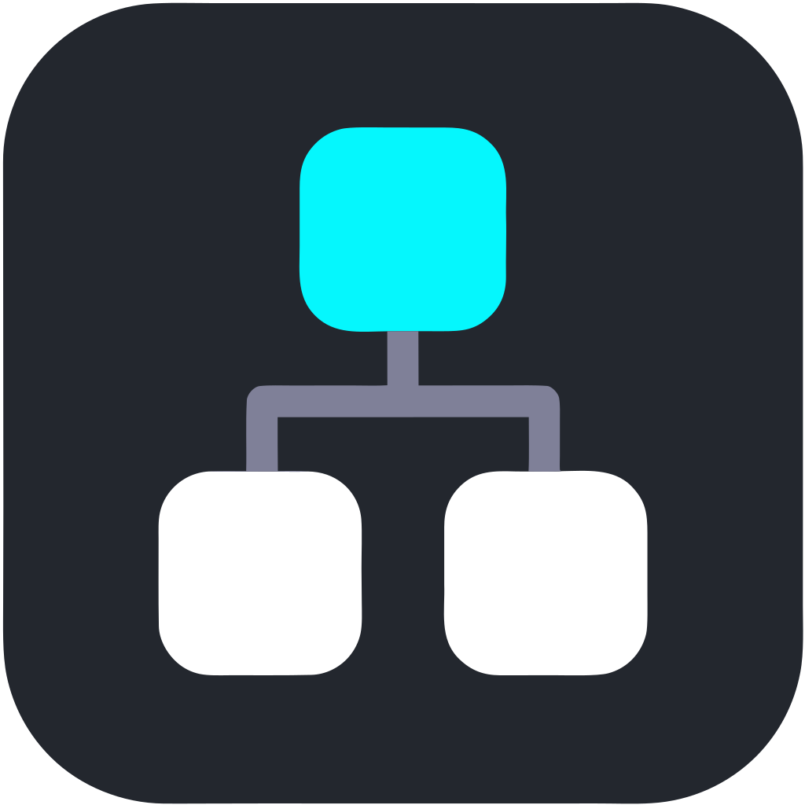
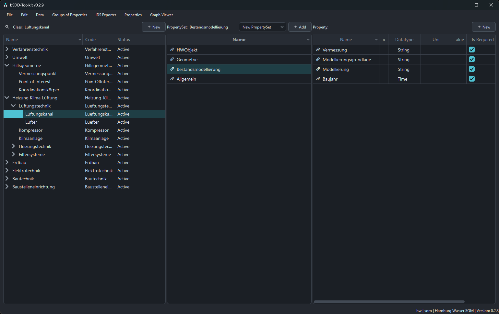
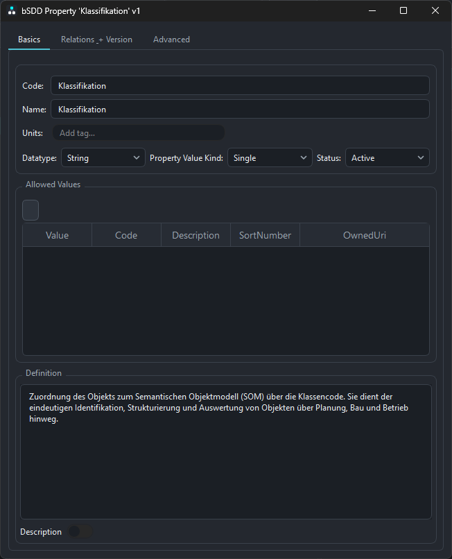
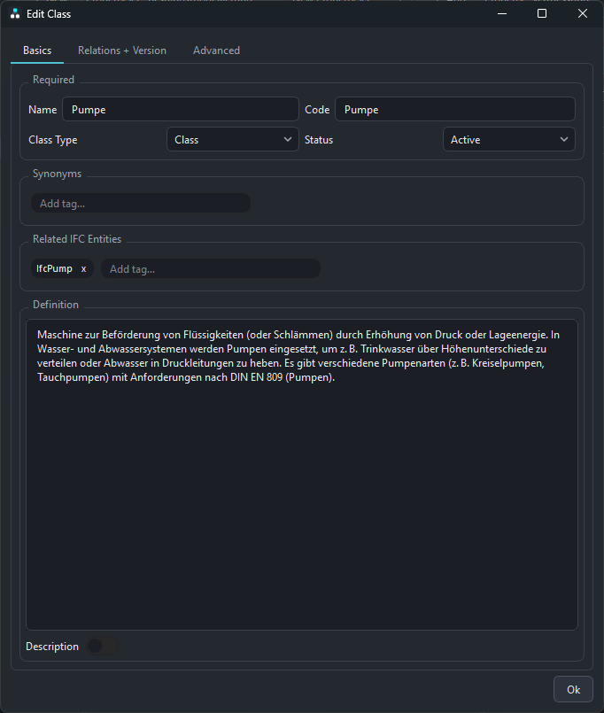
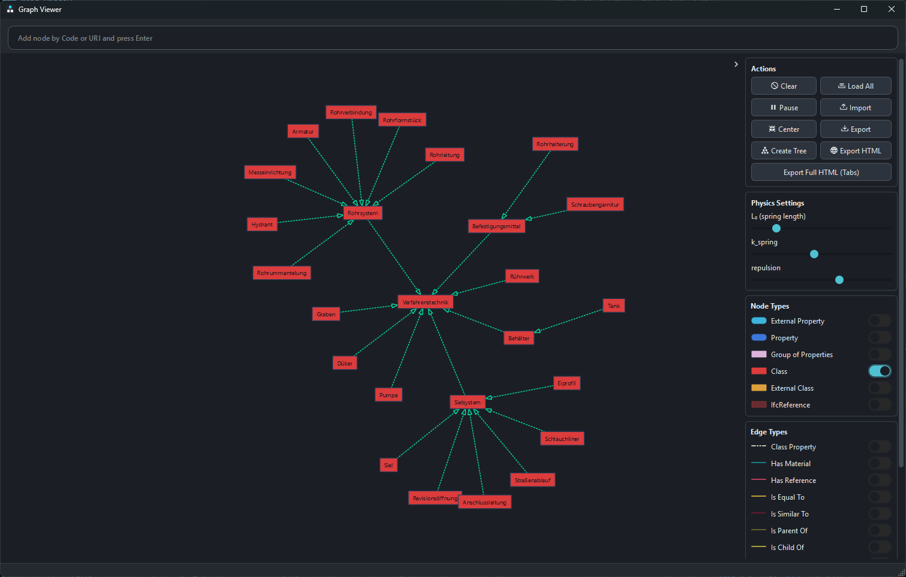
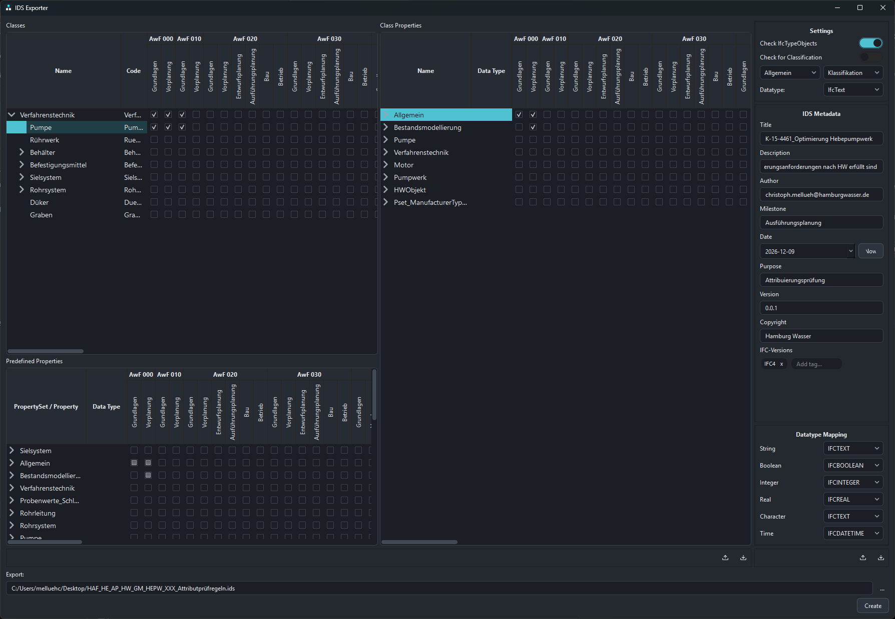

# bSDD-Toolkit

Visual editor and Python toolkit for working with buildingSMART Data Dictionary (bSDD) JSON.

This repository contains:
- A validated data model for bSDD JSON (Pydantic v2) under `src/bsdd_json`.
- A PySide6 GUI to create, view, and edit bSDD dictionaries under `src/bsdd_gui`.
- A collaborative web application (FastAPI backend `src/bsdd_web`, React frontend `web/`), see [Web application](#web-application).


## Features
- Edit dictionaries: classes, property sets, properties, and allowed values.
- Class tree with drag & drop and quick search.
- Property set and property tables with sorting and inline editing where supported.
- Relationship and IFC helpers (modules present for extension).
- Modular architecture with a lightweight plugin system.
- Multilingual-ready UI (German translation scaffold included).


## Requirements
- Python 3.10+
- Pip and a virtual environment are recommended
- Platform dependencies for Qt (PySide6) as required by your OS


## Installation

Clone the repository and install the package (editable for development or standard install):

```bash
git clone https://github.com/<your-org-or-user>/bsdd-Toolkit.git
cd bsdd-Toolkit

# (optional) create and activate a virtualenv
python -m venv .venv
# Windows
.\.venv\Scripts\activate
# macOS/Linux
source .venv/bin/activate

# install
pip install -U pip
cd src/bsdd_gui
pip install -e .            # for development
# or
pip install .               # for a regular install

# dev extras
pip install -e .[dev]       # ruff, black, mypy, pytest, etc.
```


## Run the GUI

Run the application module directly (optionally pass a path to a bSDD JSON file to open):

```bash
cd src
python -m bsdd_gui                   # start empty
python -m bsdd_gui som-0.2.0.json    # open example dictionary
```

Command-line options supported by the launcher:

```text
python -m bsdd_gui [open_path] [-l LOG_LEVEL] [-ol --open_last_project] [-ofm --offline_mode]

open_path           Optional path to a bSDD JSON file
-l, --log-level     Integer log level (e.g. 10=DEBUG, 20=INFO)
--open_last_project Open the last project on startup
--offline_mode      Start bSDD-GUI without Internet connection
```


## Screenshots

### Main Window


### Editors
| Edit Properties | Edit Classes |
| --- | --- |
|  |  |

### Graph View


### LOIN / IDS Exporter



## Web application

The web version offers the same functionality as the desktop GUI in the browser:
every dictionary you create, upload or download from bSDD gets its own **unguessable link**.
Everybody who has the link edits the dictionary **together in real time** (live updates,
presence, per-user undo/redo). Dictionaries are stored as plain bSDD JSON in a Docker volume.

Features: class tree (drag & drop, copy/paste, grouping), property sets, class properties,
property / class / dictionary editors with relations and allowed values, Groups of Properties,
Level of Information Need (ISO 7817-3), exports (Excel, IDS, ISO 23386, ISO 7817-3, Revit),
download from bSDD, fuzzy search, graph viewer, AI definitions (each user enters their own
OpenAI, Anthropic Claude or Google Gemini key; it never reaches the server), English and German UI, and a Python shell.

The web UI is organised in sections (overview with checks, classes, groups of properties,
properties, LOIN, graph, export). Every class and property has its own URL
(`/p/<id>/classes/<code>`, `/p/<id>/properties/<code>`) that can be shared, edits are made
inline with a per-field merge of concurrent changes, and <kbd>Ctrl</kbd>+<kbd>K</kbd> opens a
command palette to jump to any class, property or page.

**Graph viewer:** a custom canvas renderer with a force-directed layout engine written in Rust
and compiled to WebAssembly (`web/graph-engine`, Barnes-Hut repulsion, runs in a Web Worker).
Drag & drop with pinning, filters per node and edge type, adding nodes by name / code / URI,
expanding neighbours, straight / right-angle / curved edges, adjustable physics, tree, circle
and grid layouts, creating and deleting relations directly in the graph, PNG / SVG /
interactive HTML export, and a stand-alone window (`/p/<id>/window/graph`). The prebuilt
`web/src/graph/engine.wasm` is rebuilt from source in the Docker build (`npm run build:wasm` locally).

**Python shell without server risk:** the shell runs Python *in the visitor's browser*
(Pyodide/WebAssembly) on a local copy of the dictionary with `bsdd_json` loaded. Nothing
typed into it is executed on the server. With "Live" on, changes to `d` are sent after each
command as a small, conflict-checked patch; the server validates them like every other edit.

**Sharing and access:** there are no user accounts, access is per link (Share dialog):

- **Edit link** `/p/<id>` – optionally protected with a password. Everybody has to enter it
  once per browser before they can view or edit anything.
- **Read-only link** `/v/<other id>` – can be switched on, regenerated and protected with its
  own password. It allows browsing, searching and exporting; the server rejects every change
  made through it, and it never reveals the edit link.

Passwords are stored as salted scrypt hashes; after entering one the browser receives a signed
token. Changing the edit password signs out everybody, changing the read-only link or its
password only signs out viewers. Password attempts are rate limited.

> Without passwords anyone with a link can open it. Use HTTPS (reverse proxy) when the app is
> reachable over a network, otherwise passwords and tokens travel in clear text.

### Run with Docker Compose

```yaml
services:
  bsdd-toolkit:
    image: cmellueh/bsdd-toolkit:latest
    restart: unless-stopped
    ports:
      - "8000:8000"
    volumes:
      - bsdd-data:/data
volumes:
  bsdd-data:
```

`docker compose up -d` and open http://localhost:8000. See `compose.yaml` for all options.

| Variable | Default | Meaning |
|---|---|---|
| `DATA_DIR` | `/data` | where dictionaries are stored |
| `PORT` | `8000` | HTTP port inside the container |
| `MAX_UPLOAD_MB` | `50` | maximum upload size |
| `PROJECT_TTL_DAYS` | `0` | delete dictionaries not opened for N days (0 = never) |
| `OFFLINE` | `0` | `1` disables lookups of external classes/properties on bSDD |
| `SAVE_DELAY` | `2` | seconds after the last edit until the dictionary is written |
| `SNAPSHOT_INTERVAL` / `MAX_SNAPSHOTS` | `600` / `20` | rolling backups in `<project>/snapshots` |
| `SECRET_KEY` | *(generated)* | key for signing access tokens; by default a random key is created once in `<DATA_DIR>/secret.key` |
| `PUBLIC_URL` | *(empty)* | public address of this installation, e.g. `https://bsdd.example.org`; the buildingSMART sign-in returns to `<PUBLIC_URL>/auth/bsdd/callback` (empty = the address the browser uses) |
| `BSDD_CLIENT_ID` | *(empty)* | client ID from buildingSMART for "Sign in with buildingSMART"; empty = sign-in and full download are off |
| `BSDD_AUTHORITY` / `BSDD_SCOPE` / `BSDD_API` | buildingSMART defaults | only needed if buildingSMART changes its sign-in or API addresses |

#### Download from bSDD

Without sign-in, "Download from bSDD" loads a dictionary class by class and property by property
through the public bSDD API. Two faster ways:

- **Open a downloaded file:** download the dictionary on [search.bsdd.buildingsmart.org](https://search.bsdd.buildingsmart.org)
  ("Download", needs a buildingSMART account) and open the JSON file in the download dialog or on the start page.
- **Sign in with buildingSMART** (optional, per installation): the complete dictionary is downloaded in one request.
  buildingSMART must register your installation first: request a client ID from `bsdd_support@buildingsmart.org`
  as a *single-page application* with the return URL `<PUBLIC_URL>/auth/bsdd/callback` (use the ASCII/punycode form
  of the domain), then set `PUBLIC_URL` and `BSDD_CLIENT_ID`. The access token stays in the user's browser tab and is
  passed to buildingSMART only for the download; the server does not store it.

The server must run as a single process (open dictionaries are held in memory); the image does this by default.
A reverse proxy must forward WebSocket upgrades (`/api/projects/<id>/ws`).

### Publish the image

`.github/workflows/docker.yml` runs the tests and pushes a multi-arch image (amd64/arm64) to
Docker Hub when a tag like `web-v0.1.0` is pushed (the plain `v*` tags belong to the desktop releases). Add the repository secrets `DOCKERHUB_USERNAME`
and `DOCKERHUB_TOKEN`. Manually: `docker build -t <user>/bsdd-toolkit . && docker push <user>/bsdd-toolkit`.

### Develop

```bash
uv venv .venv-web && VIRTUAL_ENV=.venv-web uv pip install -e src/bsdd_json -e "src/bsdd_web[dev]"
PYTHONPATH=src DATA_DIR=./data .venv-web/bin/python -m bsdd_web --reload   # API on :8000
cd web && npm install && npm run dev                                       # UI on :5173 (proxies /api)
PYTHONPATH=src .venv-web/bin/python -m pytest src/bsdd_web/tests           # backend tests
cd web && npm run build && E2E_PYTHON=../.venv-web/bin/python npm run e2e  # browser tests (Playwright; once: npx playwright install chromium)
```


## Use the Data Model (Python)

Load, inspect, and write bSDD JSON using the Pydantic models:

```python
from bsdd_json import BsddDictionary, BsddClass, BsddProperty, BsddClassProperty

# Load and validate an existing dictionary (see som-0.2.0.json)
d = BsddDictionary.load("example.json")
print(d.DictionaryName, d.DictionaryVersion)

# Programmatically create a new dictionary
new_d = BsddDictionary(
    OrganizationCode="example",
    DictionaryCode="demo",
    DictionaryName="Demo Dictionary",
    DictionaryVersion="0.1.0",
    LanguageIsoCode="en-US",
    LanguageOnly=False,
    UseOwnUri=False)
# Create and add Classes
class_1 = BsddClass(Code="Wall", Name="Wall", ClassType="Class")
class_2 = BsddClass(Code="Slab", Name="Slab", ClassType="Class")
new_d.Classes += [class_1, class_2]

# Create and add Property
prop_1 = BsddProperty(Code="Height", Name="Height", DataType="Real")
new_d.Properties.append(prop_1)

# Create and add ClassProperties
class_1.ClassProperties.append(
    BsddClassProperty(Code="height", PropertyCode=prop_1.Code, PropertySet="Geometry")
)
class_2.ClassProperties.append(
    BsddClassProperty(Code="height", PropertyCode=prop_1.Code, PropertySet="Geometry")
)

# Serialize to JSON
new_d.save("example.json")
```


## Project Structure

- `src/bsdd_json` — Pydantic models and helpers for bSDD JSON.
- `src/bsdd_gui` — PySide6 GUI application (run with `python -m bsdd_gui`).
  - `__main__.py` — entry point for the GUI launcher.
  - `module/` — feature modules (class tree, property tables, search, etc.).
  - `core/` — application wiring and shared UI logic.
  - `tool/` — helper functions that get called from /core.
  - `resources/` — icons, translations, and static assets.


## Development

Useful commands when developing locally:

```bash
# formatting & linting
ruff check .
black .

# type checking
mypy src

# run the GUI during development
python -m bsdd_gui
```

## Build Your Own GUI

There are two typical ways to “build your own GUI” with this project:

1) Package this app as a standalone executable (no Python required for end users)
2) Extend the GUI with your own modules/widgets

### 1) Package a Standalone App (PyInstaller)

Prerequisites:

- Python 3.10+
- A virtual environment with the project installed
- PyInstaller installed: `pip install pyinstaller`

Build (Windows, PowerShell):

```powershell
# from the repo root
python -m venv .venv
.\.venv\Scripts\Activate.ps1
pip install -U pip
pip install .
pip install pyinstaller

# run the build
pyinstaller main.spec -y
```

Artifacts:

- Windows: `src/dist/bSDD-Toolkit/bSDD-Toolkit.exe`
- macOS/Linux: `src/dist/bSDD-Toolkit/` binary in the same folder

Notes:

- The spec (`src/main.spec`) bundles resources and sets the app name and icon.
- To hide the console window, change `console=True` to `False` in `src/main.spec` and rebuild. On Windows you can toggle the console using the UI
- VS Code users can also run the `Build` launch config, which executes `src/build.ps1`.

### 2) Extend the GUI (Create a Module)

Scaffold a new module that plugs into the app:

```bash
# from the repo root
python src/bsdd_gui/_add_module.py my_feature
```

This generates files under:

- `src/bsdd_gui/core/my_feature.py` – core hooks/logic
- `src/bsdd_gui/tool/my_feature.py` – convenience accessors to properties/state
- `src/bsdd_gui/module/my_feature/` – UI, triggers, and properties

One manual step is required: expose the new tool in
`src/bsdd_gui/tool/__init__.py` by adding an import line, e.g.

```python
from .my_feature import MyFeature
```

UI workflow (optional):

- Design Qt forms with Qt Designer and save `.ui` files under
  `src/bsdd_gui/module/my_feature/qt/`.
- Compile them to Python with `pyside6-uic`, for example:

  ```bash
  pyside6-uic src/bsdd_gui/module/my_feature/qt/Widget.ui \
    -o src/bsdd_gui/module/my_feature/qt/ui_Widget.py
  ```

Run and iterate:

```bash
python -m bsdd_gui -l 10
```

Tip: Look at existing modules in `src/bsdd_gui/module/` (for example,
`class_editor_widget` or `main_window_widget`) as reference implementations
for wiring `ui.py`, `trigger.py`, `core/*.py` and `tool/*.py` together.

## License

MIT — see `LICENSE` for details.


## Acknowledgements

- buildingSMART International for the bSDD initiative and specifications.
